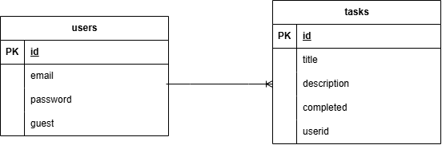
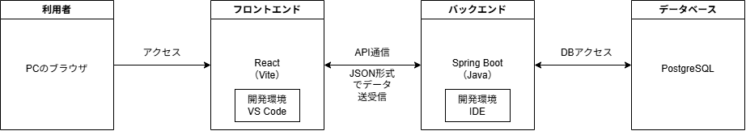

# らくらくタスク管理

誰でも使いやすく、いつでも気軽に登録できることを目指したタスク管理アプリです。


## サービスへの想い

タスクを管理する前にまずユーザ登録・認証を行い、そこではじめてサービスを利用できるというのが一般的ですが、本サービスでは登録する前にタスクを設定することができ、後からユーザアカウントの登録を行える設計となっています。
その設計として、当初はゲスト利用時に割り当てたuser_idを、後から作成したアカウントに紐づいたuser_idへデータを移し、その後ゲスト利用時のuser_idを削除する方法を考えていました。
しかしその場合処理が増えるため、user_idはそのままで、そのレコードのemailとpasswordを仮生成したものを後から更新する形を採用しました。


## サービスのURL

https://taskmanager01-one.vercel.app


## サービス利用手順

###　1.ユーザアカウントの新規登録、ゲストとしての利用開始
　URLにアクセスし、メールアドレス・パスワードを設定しアカウント登録を行います。
　テスト用アカウントとしてメールアドレス「guest」パスワード「guest」が用意されています。

　
　ゲストとして開始を選択するとアカウントを登録せずにサービスを利用できます。
　データを保存したい場合はそのままアカウント登録を行うことで引き継ぐことができます。


###　2.タスク一覧画面での操作
　利用を開始するとログインが完了しタスク管理画面へ遷移します。
　この画面ではタスクの登録、完了・未完了設定、削除が行えます。


### 3.ログアウトについて
　画面上部のログアウトボタンを押すか、画面を更新することによってログアウトされます。


## 機能一覧

- ユーザアカウント登録
- ログイン、ログアウト
- タスク一覧表示
- タスク追加
- タスク削除
- ユーザ毎のタスク管理
- ゲストで利用
- ゲストのデータを登録アカウントに移行


## 使用技術

| Category | Technology Stack |
|---|---|
| Frontend | JavaScript, React, Vite |
| Backend | Java 21, Spring Boot,Spring Data JPA |
| Authentication | Spring Security |
| Database | PostgreSQL |
| Infrastructure | Vercel, Render |
| Build tool | Maven, npm |
| Design | draw.io |
| etc. | Git, GitHub |


## ER図




## インフラ構成図




## セットアップ

### 必須環境

- Java 21
- Node.js 20
- PostgroSQL 16
- Git

### インストール手順
```bash
# 1. リポジトリクローン
git clone https://github.com/K-T-Nexarion/taskmanager01.git
cd taskmanager01

# 2. データベース作成
createdb taskmanager01

# 3. バックエンド（Spring Boot）を起動
.\mvnw.cmd spring-boot:run

# 4. フロントエンド（React）を起動（別のターミナルで実行）
cd frontend
npm.cmd install
npm.cmd run dev

# 5. ブラウザで開く
http://localhost:5173